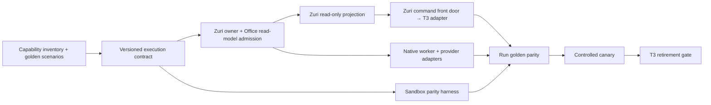

# T3 Capability Inventory and Zuri Parity Baseline

**Status:** source audit and acceptance contract only. No provider, cloud, deployment, or hosted integration was exercised or changed.

## Evidence boundary

- Visual Office source inspected at `b3da4ad8b0723ebe695685e02e8ebffc20c61507`.
- Zuri source inspected from the locally available `origin/main` Git object `6d3139dc833a6f570c6fcff5ede42f055ab5119c`. The checked-out Zuri `main` is `8bb53f7df13b307480f21e778566c352a7f62438` and reports 30 commits behind that ref. This is a pinned local Git object, not a fresh fetch or proof of current upstream state.
- T3 release contract named by Visual Office: `0.0.45`.
- Existing source tests are unit/contract tests with injected dispatch/fetch/storage ports. This pass found no browser E2E runner or test against a live T3 instance. No live status, secret, credential, or `.local` file was read.

## Current Visual Office execution path

```text
Browser → authenticated Sites Worker / R2 queue → local bridge → T3 0.0.45
        ← bounded snapshots / job results ←───────────────┘
```

| Capability | Current implementation and source | Existing evidence | Gap before a T3 replacement |
|---|---|---|---|
| Read shell and thread state | `web/t3-client.js`; `scripts/bridge.mjs` reads `/api/orchestration/shell` and bounded thread details | `tests/t3-client.test.mjs` covers normalization, malformed responses, polling, stale/offline behavior, backoff and reconnect with fake fetch | No neutral session/event contract or live reconnect/ordering proof |
| Role task dispatch | `scripts/role-runner.mjs` dispatches `thread.create` and `thread.turn.start` using durable command/thread/message IDs and `approval-required` mode | `tests/role-runner.test.mjs`; `tests/worker.test.mjs` cover queue identity/retry with injected ports | Dispatch is T3-shaped; no provider-neutral execution port or real provider receipt |
| Direct chat continuation | `scripts/chat-runner.mjs` queues a turn on the existing T3 thread; the bridge sends `thread.turn.start` | `tests/chat-runner.test.mjs`, `tests/worker.test.mjs` | No provider-independent resume/thread ownership contract |
| Team fan-out and synthesis | `scripts/role-runner.mjs` runs specialists, waits for completion, then starts synthesis; failures block synthesis | `tests/role-runner.test.mjs` | No live multi-provider/failure recovery run |
| Cancellation | Worker stores a durable cancel request; runner may send `thread.turn.interrupt` | `tests/worker.test.mjs`, `tests/role-runner.test.mjs`, `tests/work-view.test.mjs` | State does not distinctly prove requested, acknowledged, and process-stopped. Runner can mark the step cancelled after dispatching interrupt without a separate stop receipt. This is a parity blocker for truthful cancellation status. |
| Approval and user questions | Runner detects pending approvals/questions and waits; README directs the user to T3 for the decision | `tests/role-runner.test.mjs`, `tests/chat-runner.test.mjs` cover wait behavior | Office/Zuri does not own the full interaction lifecycle; no exact responder, expiry, decision receipt, or resume contract in the reviewed Office paths |
| Chat and knowledge attachments | `scripts/chat-attachments.mjs` and `scripts/knowledge-attachments.mjs` mint native T3 upload URLs, upload bytes, cache T3 IDs, and attach them to turns | `tests/chat-runner.test.mjs`, `tests/worker.test.mjs`, attachment-focused tests | Bytes, IDs and upload protocol are T3-specific; no common storage/reference/scan/authorization receipt |
| Provider/model/workspace capabilities | `scripts/chat-runner.mjs` projects capabilities from the matching T3 provider/workspace | `tests/chat-runner.test.mjs` | No live capability discovery contract that can represent unsupported operations per adapter |
| Durable work and private projection | `worker/index.js` persists jobs, chat queues, snapshots, cancellation intent and bounded file metadata in private storage | `tests/worker.test.mjs`, `tests/result-files.test.mjs`, `tests/work-review.test.mjs` | This is Office persistence, not provider-session ownership or a Zuri execution ledger |
| Bridge retry/offline behavior | `scripts/bridge.mjs` polls and backs off up to 30 seconds; Worker marks snapshots stale after 30 seconds | `tests/t3-client.test.mjs`, `tests/worker.test.mjs` | No process-kill/restart test against a real runtime and no lease/fencing proof across competing workers |
| Authentication | `scripts/t3-auth.mjs` exchanges a pairing credential for scoped bearer tokens; bridge sends private Site and sync credentials server-side | `tests/t3-client.test.mjs`, `tests/worker.test.mjs` | No cross-tenant Zuri authorization test over the complete Office → worker → adapter path |

## Zuri capabilities found in the pinned source

The independent `services/conversation-runtime` process uses the private, versioned `conversation-runtime.v1` Core contract. Its service document describes a bounded loop that claims work, obtains scoped context, invokes model/tool ports, coordinates delivery, and reports completion. Core retains identity, consent, admission, channel secrets, protected work mutations, and authoritative scope checks. The runtime gets model credentials through a claim-bound operation and keeps them in memory.

The inspected HTTP route is `apps/server/src/app/api/internal/conversation-runtime/v1/[operation]/route.js`; the implementation is under `apps/server/src/modules/line-oa-studio/application/conversation-runtime-core.js`. This proves a useful private runtime boundary and execution pattern in the LINE OA domain. It does **not** prove a general-purpose Office provider-session API equivalent to T3's create/resume/stream/interrupt/approval/attachment/workspace lifecycle.

Project Manager execution runs, approvals and traces are domain execution records and controls. Their presence alone does not establish ownership of arbitrary local provider processes or T3-style coding-agent sessions. No production cutover or live Zuri runtime routing was verified.

## Zuri owner mapping and B2 feasibility

Read-only source audit at the pinned `origin/main` object above; the checked-out Zuri `main` was still 30 commits behind. No fetch, target write, service call, or live capability probe was made.

| B1 Office contract area | Existing Zuri owner/source | Mapping result | Gap before adoption |
|---|---|---|---|
| Office command and session lifecycle | `conversation-runtime.v1` operation schema and Conversation Runtime service | **No direct mapping.** Core operations claim LINE conversation jobs; no Office `session.create`, `turn.start`, `turn.cancel`, or `interaction.respond` operation exists in this contract. | Choose an authoritative Office execution/job owner and define authenticated create/read/update boundaries. |
| Job identity, claim, lease, deadline | Core-owned `LineConversationJob` and `conversation-runtime.v1` claims | **Partial pattern only.** CR claims bind `jobId`, `executionId`, `claimantId`, version and LINE tenant/business/account; ADR-106 keeps admission and leases in Core. This is not an Office session record or permission grant. | Map IDs and fencing semantics to an Office-owned record; derive Office user, project and workspace access from trusted Core authority. |
| Event stream and projection | CR `trace`, `status`, `complete`, `fail`, `send`; Agent domain `AgentTraceEvent` | **No equivalent session projection.** These are scoped LINE job/operation records; the inspected contract has no authorized session listing, provider event cursor, or Office projection API. | Establish the authoritative read model, pagination/cursor, redaction, visibility rules and stale-state behavior. |
| Model/provider execution | CR model port and Core `credential` operation | **Not a provider-session adapter.** The runtime invokes bounded answer generation for a prepared LINE turn; there is no declared provider-owned session/resume/stream lifecycle. | Define provider session ownership and supported/unsupported capability discovery without routing Office access through LINE accounts. |
| Cancellation and recovery | Core leases/fencing and CR `fail` with `UNKNOWN`; ADR-106 restart/recovery rules | **Partial safety pattern.** No turn-cancel operation or provider termination receipt is defined in CR v1. | Add explicit request/acknowledgement/confirmed-stop evidence and bounded reconciliation before advertising truthful cancellation. |
| Interactions and attachments | CR prepared turn context and WorkTool; LINE OA Studio owns LINE conversation jobs | **No generic mapping.** WorkTool is a bounded Core business-work port; it is not provider approval UI, file upload, or workspace access. | Define interaction identity/responder/expiry and attachment storage, scanning, authorization and content receipts as separate owners. |
| Authorization | Core resolves trusted identity/consent for LINE jobs; CR service token authenticates the private service | **Not reusable as Office authorization.** ADR-106 says a service credential does not grant end-user business permissions, and its claim authority derives from LINE-owned jobs. | Require authenticated Office principal and project/workspace ACL checks; never trust client scope or reuse a LINE service token as user authority. |

**Decision for the DAG:** B2 cannot safely project Office sessions from the inspected Zuri APIs because no authoritative Office session/job projection source is declared there. Do not adapt `LineConversationJob`, `AgentTraceEvent`, or CR `status` into an Office session list by inference. Keep B2 blocked until the Zuri owner adopts an Office execution owner, read model and private authorization contract. This is a capability gap, not proof that no future Zuri design can provide it.

## Prioritized gap list

| Priority | Gap | Acceptance evidence |
|---|---|---|
| P0 | Freeze the current T3 behaviors as repeatable golden scenarios | This inventory and the test catalog in [`tests/golden-e2e-parity.md`](../tests/golden-e2e-parity.md) are reviewed against source; each scenario has setup, action, assertions and retained evidence |
| P1 | Define a versioned provider-neutral execution contract and map it to Zuri owners | Office contract covers job/session/turn/command IDs, revisions, idempotency, scope resolution, event cursor, terminal states and capability-specific `UNSUPPORTED`/`UNKNOWN`; target owners and unresolved mappings are explicit |
| P1A | Obtain/admit a Zuri Office execution owner and read-model contract | Reviewed canonical records name the owning domain/service, trusted Office principal/scope source, authoritative job/session projection, private route/auth model, provider boundary and required acceptance tests; no new behavior is implemented from an unissued draft |
| P2 | Add the Zuri read-only projection after P1A | Authorized Office roles see only permitted sessions and bounded status/results; projection is read-only, stale state is explicit, and no mutation/provider dispatch is reachable from this route |
| P3 | Put Zuri in front of T3 commands while retaining T3 as the execution owner | Create/start/cancel retries preserve IDs; mapping is durable; no duplicate execution; T3 remains authoritative for its live session |
| P4 | Build a separately authenticated Native Worker/provider adapter | Claim, lease renewal, fencing, event/report, completion/failure, cancellation acknowledgement and reconciliation survive restart |
| P5 | Implement and run the sandbox parity harness | It runs the golden catalog against a pinned baseline and candidate, captures sanitized receipts, and distinguishes `PASS` / `FAIL` / `NOT_RUN` / `BLOCKED` / `UNSUPPORTED` |
| P6 | Run parity and a bounded canary | Golden suite passes for each advertised capability in a sandbox; ownership is exclusive per job/session; failures roll back to the prior adapter without replaying effects |
| P7 | Retire T3 only after native-only proof | T3 and the old bridge are disabled in a test environment and every capability advertised as supported passes end-to-end; unsupported capabilities stay on the T3 adapter |

## Execution DAG



## Feature branches and acceptance criteria

Keep one feature per branch. The branch names below are proposed; only the inventory/spec branch is active in this checkout.

| Work item / proposed branch | Depends on | Acceptance criteria |
|---|---|---|
| B0 `codex/visual-office/zuri-t3-parity-20261011` — inventory + golden catalog | — | Source revisions are pinned; each current behavior has a source and existing-test pointer; unverified/live claims are labeled; GEP-01..13 have bounded actions and observable assertions. |
| B1 `feat/zuri-office-execution-contract` — versioned execution contract | B0 | Schema versions job/session/turn/command/interaction IDs, server-derived scope, ownership, revision, idempotency, event cursor, capability declarations and explicit `UNKNOWN`/`UNSUPPORTED`; contract tests reject invalid scope and conflicting duplicate keys. |
| B1A `feat/zuri-office-execution-owner` — target owner/adoption proposal (not dispatched) | B1 | Reviewed canonical records identify the Office execution owner, user/workspace authorization, authoritative projection/job data, private API boundary and producer/consumer test ownership. No LINE job or service token is silently repurposed. |
| B2 `feat/zuri-office-read-projection` — read-only Zuri projection | B1, B1A | Authorized Office roles see only permitted sessions and bounded status/results from the owner-approved read model; projection is read-only, stale state is explicit, and no mutation/provider dispatch is reachable from this route. |
| B3 `feat/zuri-office-t3-frontdoor` — Zuri front door with T3 adapter | B1, B1A, B2 | Create/start/cancel use stable IDs and a durable T3↔Zuri mapping; Zuri is the only Office command entry point; T3 remains the owner of its live session; retries do not create duplicate turns. |
| B4 `feat/zuri-native-worker` — Native Worker and provider port | B1, B1A | Authenticated claim/renew/fence/report/reconcile lifecycle; least-privilege Office scope; process restart and cancellation receipts; no provider secret leaves Core's approved credential boundary. |
| B5 `test/zuri-office-parity-harness` — sandbox harness | B1 | GEP scenarios are executable against adapters; harness refuses production endpoints, never dual-executes, records exact revisions and sanitized receipts, and stops on bounded retry/deadline exhaustion. |
| B6 `test/zuri-native-parity-canary` — qualification | B3, B4, B5 | Every advertised capability passes baseline and candidate evidence; unsupported capabilities remain on T3; one exclusive canary cohort is fenced and has a tested rollback path. |
| B7 `chore/retire-t3-office-adapter` — retirement | B6 | `NATIVE_ONLY` passes with T3 and bridge unavailable; no Office dependency or silent fallback to T3 remains for the declared scope; existing T3 sessions have a safe terminal/recovery path. |

After B1, B5 can proceed as a disjoint feature branch. B2 and B4 are blocked until B1A is admitted by the Zuri owners; the current LINE-only Core contract is not that admission. B3 waits for B1A and B2. Keep write sets disjoint. B6 is a hard integration barrier; B7 cannot start before B6 is accepted.

## Loop and duplicate-execution controls

- Retried commands keep the same job/session/turn/command IDs and idempotency key; never mint a new job to retry an uncertain effect.
- Admission requires an immutable `deadlineAt`; missing deadlines fail closed. Initial proposed default: at most three dispatch attempts total for one idempotent command, plus one read-only reconciliation attempt after an ambiguous external outcome. These are new control-plane defaults, not current T3 guarantees.
- Apply capped exponential backoff within the deadline and an adapter circuit breaker. Once the deadline, attempt budget, or breaker is exhausted, transition to a terminal blocked/manual-reconciliation state; do not auto-extend the deadline or recursively create a successor job.
- Worker lease and fencing token allow only one execution owner for a job/session. A stale worker cannot report events or side effects after ownership changes.
- Gate failures remain `BLOCKED` against the failed revision. Re-entry requires a new explicit decision/revision and a bounded attempt budget; the orchestrator cannot self-approve its own failed gate.
- Every autonomous loop must make monotonic progress: consume a finite retry budget, advance a durable revision/cursor, or stop with a typed failure. Repeating the same state and input is a blocker, not progress.
- The bridge's periodic health/snapshot polling may continue while the service is alive; it must never create a new command identity or replay a non-idempotent provider effect just because a poll timed out.

## Gate rules

- A test run is scoped to a dedicated sandbox project/workspace and harmless prompts; do not use real business side effects to compare providers.
- Record exact Visual Office and Zuri source revisions, runtime/provider versions, scenario IDs, opaque job/session/turn/command IDs, receipts, and `PASS` / `FAIL` / `NOT_RUN` / `BLOCKED` for each scenario. Never store credentials or full sensitive provider output in receipts.
- A dispatch HTTP success is not proof of provider completion. A cancellation request is not proof that the process stopped. An unknown side effect is reconciled before retry.
- Recorded-event and fixture comparisons are read-only. Never send the same turn to T3 and Native as a shadow test.
- Any unimplemented capability is explicitly `UNSUPPORTED` or `UNKNOWN`; it cannot count as full parity. Keep the T3 adapter for partial parity.
- T3 retirement requires a native-only run with T3 and its bridge unavailable, plus passing end-to-end evidence for every capability the Office advertises as supported.
